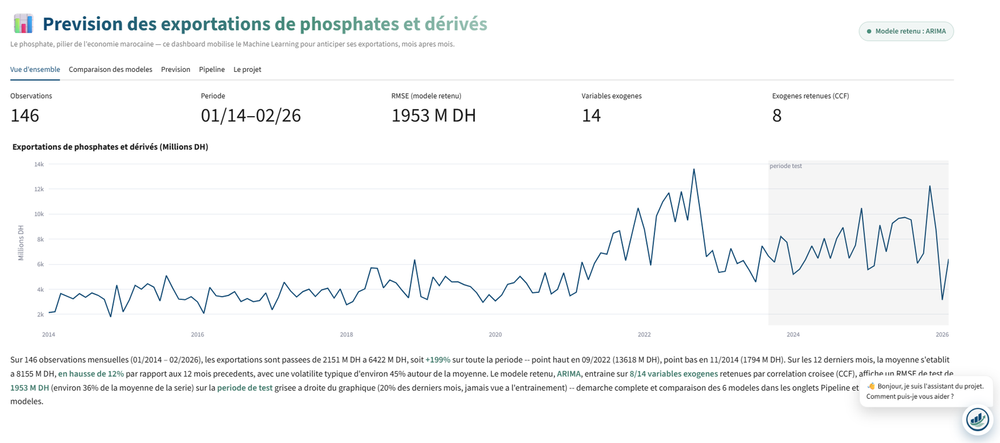
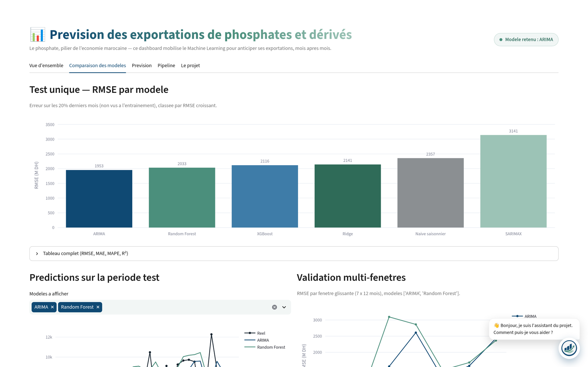
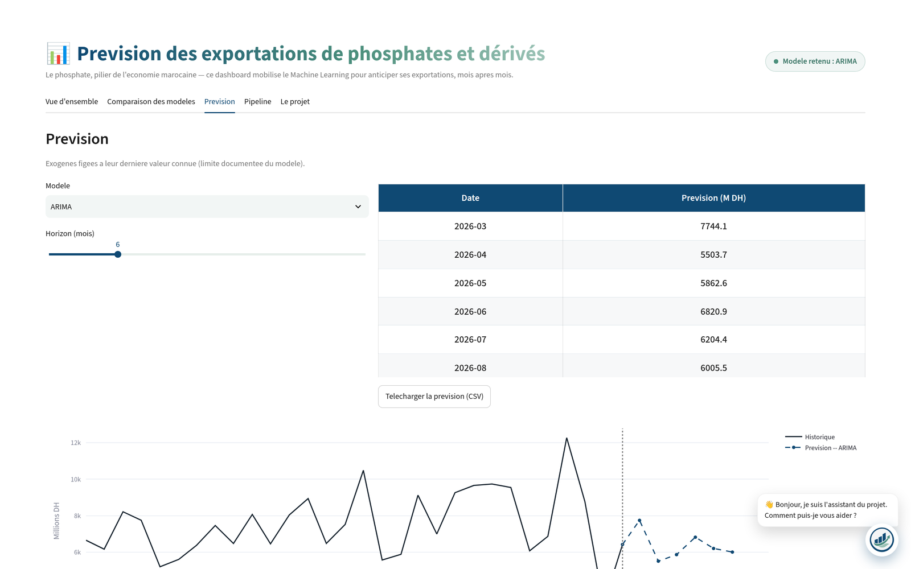
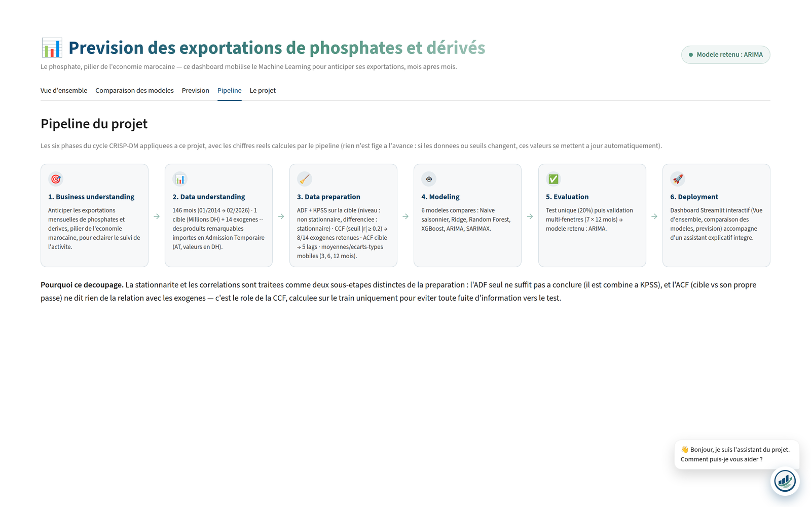
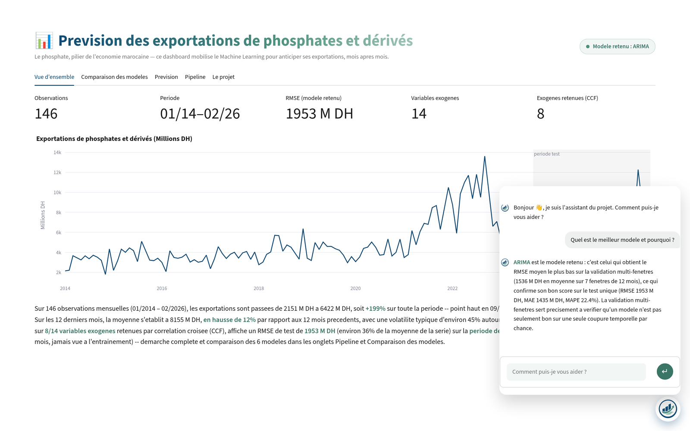

# 📊 Prévision des exportations marocaines de phosphates

> **Séries temporelles ou Machine Learning ?** Six modèles comparés sur 12 ans de données mensuelles pour prévoir les exportations de *Phosphates et dérivés*, pilier du commerce extérieur marocain.


Projet réalisé par **Yahya Tamouch** (INSEA, filière Biostatistique, Démographie et Big Data) lors d'un stage de découverte au **Ministère de l'Économie et des Finances**.



---

## 🎯 En bref

| | |
| --- | --- |
| **Question** | Peut-on anticiper les exportations mensuelles de phosphates et dérivés, et quel type de modèle le fait le mieux ? |
| **Données** | 146 mois (01/2014 → 02/2026) · 1 cible en millions de DH · 14 variables exogènes (importations en Admission Temporaire) |
| **Méthode** | CRISP-DM · stationnarité (ADF + KPSS) · sélection des retards par CCF/ACF · 6 modèles · validation sur 7 fenêtres glissantes |
| **Résultat** | Un **ARIMA(2,1,0)**, sans variable exogène, fait mieux que Random Forest, XGBoost et Ridge |
| **Livrables** | Notebook d'analyse · pipeline Python testé · dashboard Streamlit · CLI · assistant explicatif |

---

## 🏆 Résultats

**Test unique** : 30 derniers mois (09/2023 → 02/2026), jamais vus à l'entraînement, prévision à un mois.

| Rang | Modèle | RMSE (M DH) | MAE (M DH) | MAPE |
| :-: | --- | --: | --: | --: |
| 🥇 | **ARIMA** (autorégressif pur) | **1 953** | **1 435** | **22,4 %** |
| 🥈 | Random Forest | 2 033 | 1 508 | 25,2 % |
| 🥉 | XGBoost | 2 116 | 1 600 | 26,6 % |
| 4 | Ridge | 2 141 | 1 654 | 23,7 % |
| 5 | Naïf saisonnier (baseline) | 2 357 | 1 764 | 23,9 % |
| 6 | SARIMAX (avec exogènes) | 3 141 | 2 460 | 35,3 % |

**Validation multi-fenêtres** : 7 fenêtres de 12 mois (2019 → 2026), pour ne pas dépendre d'un seul découpage.

| Modèle | RMSE moyen (M DH) |
| --- | --: |
| **ARIMA** | **1 536** |
| Random Forest | 1 831 |

### 💡 Ce qu'il faut retenir

- **La simplicité gagne.** Le modèle le plus parcimonieux obtient la plus faible erreur sur le test comme sur les 7 fenêtres.
- **Les exogènes n'apportent pas de gain.** SARIMAX, qui les intègre, est le moins bon modèle : trop de paramètres pour 116 mois d'entraînement.
- **Un score unique ne suffit pas.** Selon la fenêtre, le RMSE d'ARIMA varie de 572 à 2 608 M DH. La performance dépend fortement de la période testée.
- **Le R² est négatif pour tous les modèles** sur le test. La période test varie peu (écart-type ≈ 1 870 M DH), et même la meilleure erreur (1 953) reste du même ordre. Le notebook l'explique en détail.

---

## 🔬 Démarche (CRISP-DM)

| Étape | Ce qui a été fait |
| --- | --- |
| 1️⃣ Compréhension du besoin | Anticiper les exportations mensuelles pour éclairer le suivi de l'activité |
| 2️⃣ Compréhension des données | 146 mois, cible en millions de DH, 14 importations AT converties dans la même unité |
| 3️⃣ Préparation | Split temporel 80/20 **avant** toute analyse · ADF + KPSS (cible non stationnaire, stationnaire après différenciation) · CCF sur le train : 8 exogènes retenues sur 14 · 5 retards de la cible choisis par ACF · moyennes et écarts-types mobiles (3, 6, 12 mois) · encodage cyclique du mois |
| 4️⃣ Modélisation | Naïf saisonnier, Ridge, Random Forest, XGBoost (GridSearch + `TimeSeriesSplit`), ARIMA et SARIMAX (ordre choisi par AIC) |
| 5️⃣ Évaluation | Test unique puis validation sur 7 fenêtres glissantes · modèle final choisi sur la validation multi-fenêtres |
| 6️⃣ Déploiement | Réentraînement sur toutes les données · dashboard Streamlit · CLI · assistant explicatif |

🛡️ **Aucune fuite de données** : stationnarité, corrélations et retards sont calculés sur le train uniquement, avec des retards toujours ≥ 1 mois. Les tests automatisés le vérifient.

---

## 🖥️ Le dashboard


| Comparaison des modèles | Prévision |
| --- | --- |
|  |  |
| **Pipeline CRISP-DM** | **Assistant** |
|  |  |

> Le dashboard tourne en local (`streamlit run app.py`) : il n'est pas hébergé en ligne, car les données sont confidentielles.

🤖 **Assistant explicatif** : il répond aux questions sur la démarche et les résultats à partir des chiffres réels du pipeline. Par défaut, un routeur par mots-clés, gratuit et déterministe. En option, un LLM (API Anthropic) prend le relais pour les questions hors routeur, avec les résultats injectés dans son contexte pour éviter toute réponse inventée.

---

## 🚀 Lancer le projet

> 🔒 **Données non publiées.** Les données brutes sont confidentielles et ne figurent pas dans ce dépôt. Le notebook est publié **déjà exécuté** : toute l'analyse se lit directement sur GitHub. Pour relancer le code, placez `data_phosphates.xlsx` dans `data/` (format décrit dans [`data/README.md`](data/README.md)).

```bash
git clone https://github.com/<votre-identifiant>/phosphates-exports-forecasting.git
cd phosphates-exports-forecasting
pip install -r requirements.txt

streamlit run app.py        # dashboard (premier lancement : entraînement ~30-45 s)
pytest tests/ -v            # 10 tests de non-régression
```

**CLI** (usage scripté) :

```bash
python cli.py evaluate                                   # résultats des 6 modèles
python cli.py predict --horizon 6 --output forecast.csv  # prévision exportée
python cli.py predict --model "Random Forest" --what-if "engrais=+20%"   # scénario
```

---

## 📁 Structure

```
├── Prevision_Exportations_Phosphates.ipynb   # analyse complète, exécutée
├── pipeline.py        # logique métier : données, CCF, features, 6 modèles, évaluation, prévision
├── app.py             # dashboard Streamlit + Plotly
├── assistant.py       # assistant explicatif (routeur + LLM optionnel)
├── cli.py             # interface en ligne de commande
├── plots.py           # graphiques PNG de la CLI
├── tests/             # tests pytest (fuite de données, cohérence, what-if)
├── data/README.md     # format attendu des données (fichier non publié)
└── docs/images/       # captures du dashboard
```

---

## ⚠️ Limites et pistes

- **Exogènes figées** : pour prévoir, chaque exogène est maintenue à sa dernière valeur connue. Une vraie prévision demanderait de prévoir aussi ces 14 séries.
- **Pas d'intervalle de confiance** affiché pour l'instant ; ARIMA est évalué à un mois mais le dashboard prévoit jusqu'à 24 mois.
- **Sélection CCF exploratoire** : le seuil |r| ≥ 0,20 est proche du niveau du bruit sur ~105 observations. Le faible apport des exogènes est cohérent avec ce constat.
- **Pistes** : baseline de persistance y(t−1), intervalles de prévision, réévaluation à chaque nouvelle donnée, suivi des changements de régime.

---

## 🙏 Remerciements

À **M. Mohamed Mustapha Kabbaj**, encadrant du stage, pour son accompagnement et ses conseils, et à **Mme Zineb Berbich**, Chef du Service Informatique, pour avoir permis la réalisation de ce projet.

---

<sub>📄 Code sous licence MIT. Les données ne sont pas couvertes par cette licence et ne sont pas distribuées.</sub>
